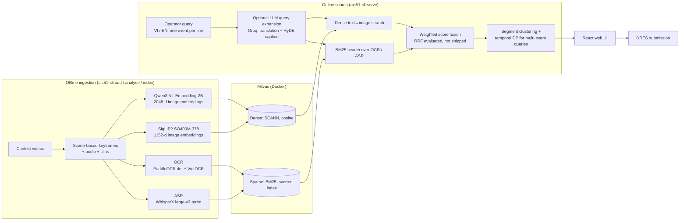

# Vecna: multimodal video retrieval for AI Challenge HCMC 2026

**Vecna** is the interactive video search engine Team Vecna built for the **Ho Chi Minh City AI Challenge 2026 (AI Challenge TP.HCM 2026)**, where the 5-person team received an **Honors Award**.
An operator types a Vietnamese or English description of a scene, such as an event, an on-screen caption, or something said aloud. Vecna searches **1,487 Vietnamese videos totaling 340+ hours**, released in two batches.
It combines Qwen3-VL and SigLIP2 visual embeddings with OCR and ASR text search over a Milvus index, then fuses the ranked lists. Results appear in a keyboard-driven React UI that submits answers straight to the contest's DRES evaluation server.

> The contest videos, keyframes and official queries belong to the AI Challenge organizers and are **not** distributed in this repository.

## Architecture



| Layer | Implementation |
|---|---|
| Ingestion | [`aic51-src/aic51/packages/analyse/features/`](aic51-src/aic51/packages/analyse/features/): `qwen_vl.py`, `image_siglip.py`, `ocr.py`, `asr.py` (plus CLIP, BGE-M3 and YOLO extractors that are switched off in the contest config) |
| Index | [`packages/index/milvus.py`](aic51-src/aic51/packages/index/milvus.py): one collection per corpus batch, SCANN (nlist 512) for vectors, BM25 (k1 1.2, b 0.75) for text |
| Search and fusion | [`packages/search/searcher.py`](aic51-src/aic51/packages/search/searcher.py), [`llm_expander.py`](aic51-src/aic51/packages/search/llm_expander.py) |
| API and UI | FastAPI backends ([`packages/webui/backend/`](aic51-src/aic51/packages/webui/backend/)) and a React + Vite frontend ([`packages/webui/frontend/`](aic51-src/aic51/packages/webui/frontend/)) |
| Contest submission | [`DresSubmitPanel.jsx`](aic51-src/aic51/packages/webui/frontend/src/components/DresSubmitPanel.jsx), plus a standalone portal ([`submitter_server.py`](submitter_server.py), [`dres_submitter.html`](dres_submitter.html)) |
| Technical report | [`AIC2026_Technical_Report.pdf`](AIC2026_Technical_Report.pdf) (source in [`report/main.tex`](report/main.tex)) |

## Results

These come from the team's **113-query development benchmark**: 115 query identities, with 2 excluded because no answer could be scored.
The ground truth is team-built, not organizer gold. Each row names its metric, and the two tables use **different scoring surfaces**, so don't compare them directly.

| Experiment | Metric | Result | Decision | Details |
|---|---|---|---|---|
| Fusion sweep: 5 fusion rules on one frozen capture of the same provider hits (Qwen3-VL, SigLIP2, OCR-BM25, ASR-BM25) | Distinct-video R@20 / MRR@20 | **Weighted score sum: 87/113, MRR 0.529989**<br/>RRF (k=60): 85/113, MRR 0.433591 | Keep weighted sum (shipped) | [docs/results/fusion_sweep_113.md](docs/results/fusion_sweep_113.md) |
| Reranker audit: Qwen3-VL reranker over the top-20 | Range/event R@20 (stricter) | **68 → 76/113** (+9 / −1 queries; R@1 41 → 40)<br/>**28.2 s per query** (p50 28.0, p95 30.7) | Not shipped; kept as an opt-in experiment | [docs/results/reranker_audit_113.md](docs/results/reranker_audit_113.md) |

All comparisons are paired, with 10,000-resample bootstrap 95% intervals. The full evidence packets (per-query outputs, provenance hashes, reproduction scripts) live on the `btl/issue-82-*` research branches and their draft PRs.

## Setup

**Requirements**
- Python 3.11 (3.10+ works)
- An NVIDIA GPU with CUDA 12.8 drivers, for Qwen3-VL, SigLIP2 and WhisperX
- [Docker](https://www.docker.com/), running. Milvus starts automatically through `docker compose`.
- [Node.js](https://nodejs.org/) 18+ and npm, for the web UI
- [ffmpeg](https://ffmpeg.org/) and [Tesseract](https://github.com/tesseract-ocr/tesseract) on `PATH`

**Install**

```bash
git clone https://github.com/JimmyK300/Vecna.git
cd Vecna
python -m venv .venv
source .venv/bin/activate          # Windows: .\.venv\Scripts\activate
pip install -r requirements.txt    # pinned CUDA 12.8 wheels, plus `pip install -e ./aic51-src`
```

This installs the `aic51-cli` command.

**Build a workspace and index your videos**

```bash
mkdir workspace && cd workspace
aic51-cli init                       # writes the default config.yaml and folder layout
cp ../config.yaml .                  # optional: use the exact contest configuration
aic51-cli add /path/to/videos -d -k -c   # -d: folder of videos, -k: keyframes, -c: clips
aic51-cli analyse                    # run every feature extractor enabled in config.yaml
aic51-cli index                      # start Milvus (Docker) and load features
aic51-cli serve                      # API and web UI at http://localhost:6900
```

- Use `aic51-cli --dev serve` to run the frontend with Vite hot reload on port 5173.
- `serve --no-frontend` and `serve --no-backend` start only one half.
- Any folder of `.mp4` files works for trying the system. To get the contest data, contact the AI Challenge HCMC organizers.

**Optional: LLM query expansion.** This is off by default (`searcher.llm.enable: false`). To turn it on, set the flag to `true` and give it a key through the environment, not the config file:

```bash
export GROQ_API_KEY=...            # PowerShell: $env:GROQ_API_KEY="..."
```

**Tests**

```bash
cd aic51-src && python -m pytest tests -q
```

## Repository layout

```
aic51-src/        Python package: CLI, feature extractors, Milvus indexing, search, FastAPI + React UI
config.yaml       configuration used in the contest
docs/             design notes, literature reviews, CLI docs, results/
report/           LaTeX source of the technical report
submitter_server.py, dres_submitter.html, open_submitter.bat   standalone DRES submission portal
```

## Team

Team Vecna, AI Challenge HCMC 2026:

| Member | GitHub |
|---|---|
| Cao Chí Minh (Team Lead) | [@JimmyK300](https://github.com/JimmyK300) |
| Lê Tuấn Kiệt | [@ProfK602170](https://github.com/ProfK602170) |
| Nguyễn Lê Minh Hoàng | [@nlmhoagn](https://github.com/nlmhoagn) |
| Ngô Đắc Minh | [@kinus-is-coding](https://github.com/kinus-is-coding) |
| Phan Hiếu Minh | [@PhanHieuMinh](https://github.com/PhanHieuMinh) |

## Credits

Vecna is built on **AIC51**, an open-source AI Challenge retrieval engine released under the MIT License (© 2024 trnKhanh; see [`aic51-src/LICENSE`](aic51-src/LICENSE)).
This repository's history from August 2024 to February 2026 is upstream AIC51 work, contributed by @tb-tian, @stphtt and @hieutruong-persefoni among others.
Vecna also builds on [Milvus](https://milvus.io/), [Qwen3-VL](https://github.com/QwenLM/Qwen3-VL), [OpenCLIP](https://github.com/mlfoundations/open_clip), [PaddleOCR](https://github.com/PaddlePaddle/PaddleOCR), [VietOCR](https://github.com/pbcquoc/vietocr), [WhisperX](https://github.com/m-bain/whisperX) and [DRES](https://github.com/dres-dev/DRES).
